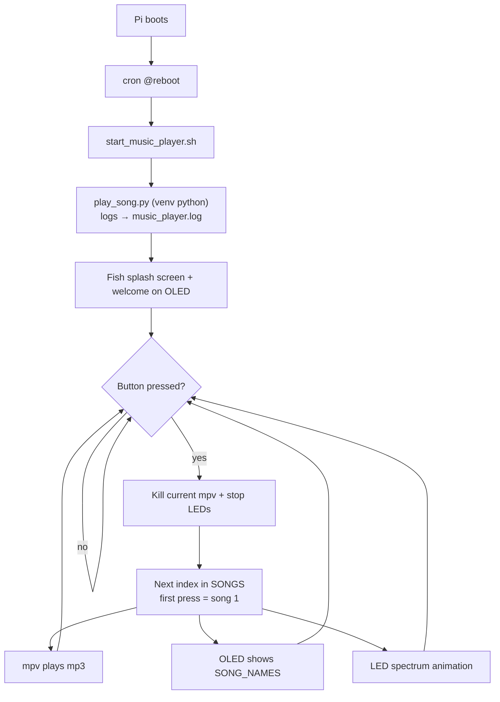
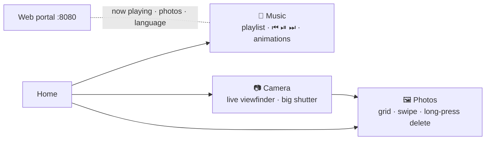
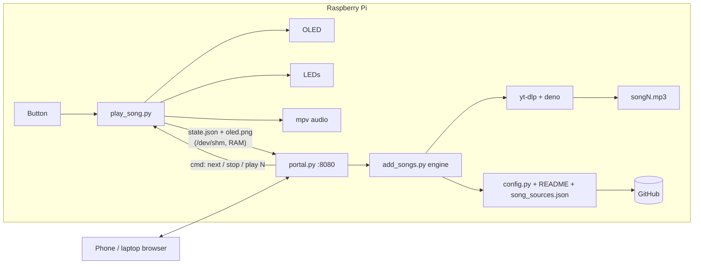
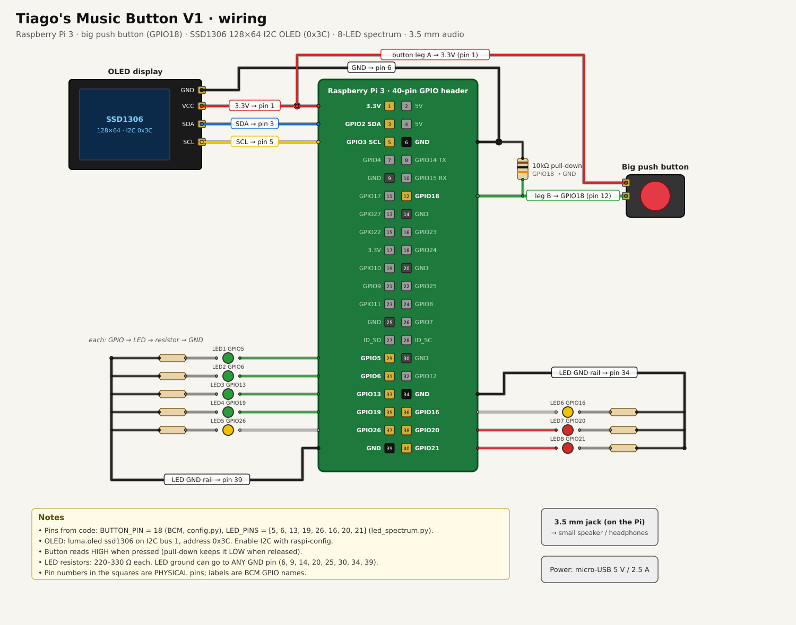
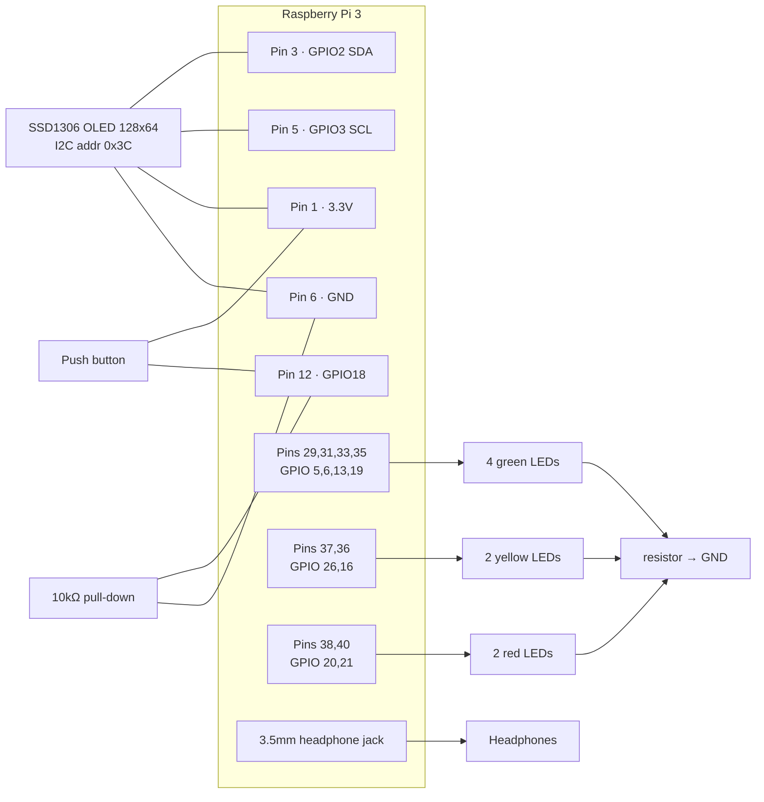
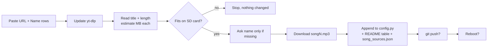
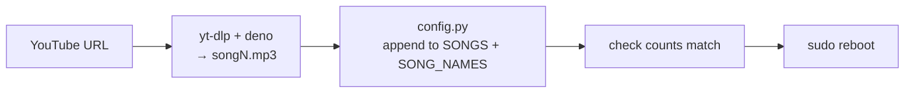

# 🎵 Tiago's Music Button (Raspberry Pi 3)

A kid-friendly music box. Press the big button → a song plays through the headphone jack, its name shows on an OLED screen, and 8 LEDs dance like a spectrum meter. Each press skips to the next song.

## How it works



## V2: handheld touch version (in progress)

Pi 3 + Waveshare 4.3" DSI capacitive touch (800×480) + PiSugar S Plus 5000 mAh battery + Pi camera. Touch only, no buttons. Lives in `v2/`; V1 is untouched.



**Stack (back to front):** screen → standoffs → PiSugar → Pi 3 (camera ribbon on CSI, display ribbon on DSI). Charge via the PiSugar's USB port, never the Pi's.

**Setup (once):**
```bash
git clone https://github.com/fgomecs/music-button-pi.git ~/music-button-pi   # if not cloned yet
cd ~/music-button-pi && git pull && bash v2/setup.sh
sudo reboot
```
`setup.sh` installs packages, enables the 4.3" DSI screen overlay, copies the songs from V1 over Wi-Fi (read-only), starts the kids app at boot, and installs the portal.

- Video is locked: audio-only downloads and playback (`v2/settings.json` → `video_unlocked`).
- Photos: `~/Pictures/kidbox` (download/delete from the portal's Photos card).
- Language: English/Español switch in the portal.
- Test on a PC: `KIDBOX_WINDOW=1 python3 v2/kidbox.py`

## Web portal

Open **http://tiagosmusicbox.local:8080** from any phone or computer on the home Wi-Fi.

- **Now playing**: live mirror of the OLED screen (fish animation, song name) and the 8 LEDs, elapsed time
- **Controls**: Next (same as the button), Stop, ▶ any song in the list, Restart player
- **Storage**: song count, library size, free space, and how many more fit at 1 / 2 / 5 / 10 / 15 / 20 MB each
- **Add songs & stories**: paste `URL Name` rows → *Check size & space* → edit names → *Download & add* (updates config, README, GitHub, restarts the player)



**Install once** (starts now and at every boot):
```bash
cd ~/music-button-pi && git pull
python3 portal.py --install
```
No extra packages needed (Python standard library only). No password: anyone on your Wi-Fi can open it.

## Wiring



_Diagram source: `docs/src/gen_v1.py` (regenerate: `cd docs/src && python3 gen_v1.py ../wiring-v1.svg && rsvg-convert -w 1500 ../wiring-v1.svg -o ../wiring-v1.png`)._



### LED pins (BCM, from `LED_PINS` in `led_spectrum.py`)

| LED | Color | GPIO | Physical pin |
|---|---|---|---|
| 1–4 | green | 5, 6, 13, 19 | 29, 31, 33, 35 |
| 5–6 | yellow | 26, 16 | 37, 36 |
| 7–8 | red | 20, 21 | 38, 40 |

Each LED: GPIO → LED → resistor → GND. While a song plays, a light wave runs green → red and back.

## Files

| File | Purpose |
|---|---|
| `config.py` | **The only file to edit for songs.** `BUTTON_PIN`, `SONGS` (file paths, play order), `SONG_NAMES` (OLED text, same order) |
| `play_song.py` | Main loop: button / portal command → mpv + OLED + LEDs; publishes live state |
| `portal.py` | Web portal on port 8080 (`--install` adds it to crontab) |
| `musicstate.py` | Shares now-playing, OLED frame and LED state between player and portal |
| `v2/kidbox.py` | V2 touch app (music, camera, photos) |
| `v2/setup.sh` | V2 one-time setup |
| `add_songs.py` | Add songs/stories in bulk + library/space report (CLI, also used by the portal) |
| `song_sources.json` | YouTube URL of each song file (used to skip duplicates) |
| `animations.py` | OLED: fish splash, welcome, song name, goodbye |
| `led_spectrum.py` | LED setup and spectrum animation |
| `oled_animations.py`, `tiagomyson_animation.py` | Extra OLED animations |
| `start_music_player.sh` | Launcher called by cron at boot |
| `test_*.py`, `button_test.py` | Hardware test scripts |

Songs (`song*.mp3`) are **not** in the repo (copyrighted audio). Re-download them with the steps below.

## Song list (play order)

<!-- SONGS:START -->
| # | File | Name | Source |
|---|---|---|---|
| 1 | song11.mp3 | Capi Miau! |  |
| 2 | song10.mp3 | Cacho Muchacho |  |
| 3 | song9.mp3 | Abuelito dime tu |  |
| 4 | song6.mp3 | Las Vocales |  |
| 5 | song7.mp3 | I'm an Octupus |  |
| 6 | song8.mp3 | This little light |  |
| 7 | song2.mp3 | Here Comes Santa |  |
| 8 | song3.mp3 | Caminito de la Escuela |  |
| 9 | song4.mp3 | La Patita |  |
| 10 | song5.mp3 | Soy un Pez! |  |
| 11 | song.mp3 | El Chorrito | https://www.youtube.com/watch?v=l82wUVuzegY |
| 12 | song12.mp3 | Daniel Otono | https://www.youtube.com/watch?v=5x5fwwxps3M |
| 13 | song13.mp3 | Sun Thief | https://www.youtube.com/watch?v=XOMu1TjtKcg |
| 14 | song14.mp3 | Snow Thief | https://www.youtube.com/watch?v=wCoo8oYT6Hg |
| 15 | song15.mp3 | Pumpkin Thief | https://www.youtube.com/watch?v=tcUcHymN1hE |
| 16 | song16.mp3 | Leaf Thief | https://www.youtube.com/watch?v=F22td-WJpX4 |
| 17 | song17.mp3 | Dont Touch that Flower | https://www.youtube.com/watch?v=C7a7XgxTtn8 |
| 18 | song18.mp3 | Daniel Margaret | https://www.youtube.com/watch?v=KXf9Y7_S-7k |
| 19 | song19.mp3 | Daniel Picnic | https://www.youtube.com/watch?v=SA2fFhdydDE |
| 20 | song20.mp3 | Daniel Escuela | https://www.youtube.com/watch?v=RUZmqgIELvo |
<!-- SONGS:END -->

_This table is rebuilt automatically by `add_songs.py`._

## Adding songs (automatic, recommended)

```bash
cd ~/music-button-pi && git pull
python3 add_songs.py
```



- Paste one song per line as `URL Name` (several lines at once is fine), then an empty line:
  ```
  https://www.youtube.com/watch?v=abc123 La Patita
  https://www.youtube.com/watch?v=def456 | Soy un Pez!
  ```
  `|`, comma or tab between URL and name also work. Lines without a name get asked later.
- `python3 add_songs.py --list` shows the library with sizes, free space and how many more fit at 1–20 MB each.
- `python3 add_songs.py --check` reports size and fit for pasted rows without changing anything.
- URLs already in the library are skipped automatically.
- At the end it can restart the player directly (no reboot needed).
- Size estimate assumes ~160 kbps mp3 and keeps 500 MB free; songs that fail to download are skipped.
- `config.py.bak` holds the previous config.

## Adding a new song (manual)



1. **One-time setup** (since late 2025 YouTube requires a JS runtime):
   ```bash
   sudo apt install -y unzip
   curl -fsSL https://deno.land/install.sh | sh
   ```
2. **Update yt-dlp + challenge solver:**
   ```bash
   ~/yt-dlp-venv/bin/pip install -U "yt-dlp[default]"
   ```
3. **Download** (pick the next free number):
   ```bash
   export PATH="$HOME/.deno/bin:$PATH"
   ~/yt-dlp-venv/bin/yt-dlp -x --audio-format mp3 -o "/home/tiago/music-button-pi/songN.mp3" "YOUTUBE_URL"
   ```
4. **Edit `config.py`**: add the path to the end of `SONGS` and the name to the end of `SONG_NAMES` (put a comma on the previous last line).
5. **Check:**
   ```bash
   python3 -c "import config; print(len(config.SONGS), len(config.SONG_NAMES))"   # must match
   ```
6. `sudo reboot`

⚠️ Never define `SONGS` / `SONG_NAMES` inside `play_song.py`; that overrides `config.py` and mismatches names vs audio.

## Troubleshooting

| Symptom | Fix |
|---|---|
| `This video is not available` + JS runtime warning | Do steps 1–2 above (deno + `yt-dlp[default]`) |
| Name on screen ≠ song playing | `SONGS` and `SONG_NAMES` out of sync, or a local copy in `play_song.py` |
| No sound | `pactl set-default-sink alsa_output.platform-bcm2835_audio.stereo-fallback` |
| Portal won't open | `pgrep -f portal.py` · `tail portal.log` · rerun `python3 portal.py --install` |
| Nothing at boot | `crontab -l` should show `@reboot /home/tiago/music-button-pi/start_music_player.sh`; check `music_player.log` |
| `git push` → Permission denied (publickey) | Add `~/.ssh/id_ed25519.pub` at github.com/settings/keys |

## Software

Raspberry Pi OS Bookworm (64-bit) · Python venv at `~/yt-dlp-venv` (runs the player too: RPi.GPIO, luma.oled, yt-dlp) · mpv · ffmpeg · deno
